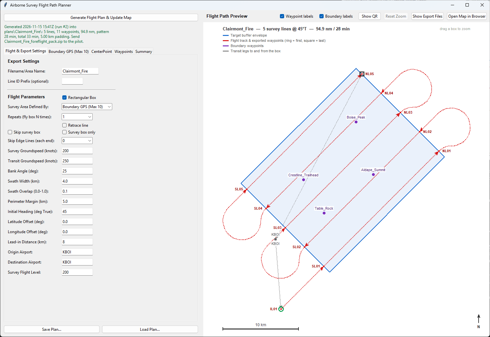

# Airborne Survey Flight Planner

A Tkinter GUI that generates airborne survey flight patterns over a fire or target area and
exports waypoints for ForeFlight and a Honeywell FMS.



Above: a 4 km swath at Initial Heading 045, flown at a survey groundspeed of 200 kt with
250 kt in transit, from and back to KBOI. Five equal-length lines run north-east, each end
named for the compass end it sits at — N/S, since a 045 diagonal is named on that pair. The dotted loops between them are the turns the
aircraft has to fly at 25° of bank — 45° teardrops, because the 3.6 km line spacing is
tighter than a turn diameter — counted in the time but never written as waypoints. `IL01` is
an 8 km lead-in on the first line's bearing, and the grey legs are the transit from KBOI and
back. The Summary tab for this plan reads: In-Pattern Time 28 min, Outbound Transit 1 min,
Inbound Transit 3 min, Total Flight Time 33 min.

## Features
- Interactive Tkinter GUI to define the survey area by either boundary vertices or a center point rectangle, plus flight parameters
- Generates an optimized rectangular survey pattern based on swath width, overlap, heading, and margins
- Exports two CSV formats: ForeFlight-friendly and Honeywell-friendly
- Draws a scaled flight-path preview directly in the window (native Tk canvas — no browser engine needed)
- Optional Esri basemap under the preview, and click-to-place for boundary points, waypoints and the centre point
- Exports a KML/KMZ map layer and a ForeFlight content pack for getting the pattern onto an iPad
- Saves and reloads a whole plan — boundary points and every parameter — as JSON
- Renders a scannable QR of the ForeFlight route link right in the window (no Pillow needed)
- **Open in ForeFlight** hands the same route to ForeFlight when it is installed on the device
- **First Line** chooses which side of the box is flown first, offered by compass edge for the heading
- Keeps **Generate Flight Plan & Update Map** and status feedback pinned above the tabs for laptop-height screens
- Shows flight summary output in a dedicated **Summary** tab for easier access on smaller displays
- Estimates in-pattern, outbound, inbound and total flight time, with separate survey and
  transit groundspeeds and the turns between lines flown at a set bank angle
- Places ICAO origin and destination airports (`KLAX`, `KSLC`) from a built-in airport table

## Web app
`web/` is the same planner as a web page, for people who do not have Python. It is a static
site: the planning code (`web/survey_engine.py`) runs inside the visitor's browser, so the
coordinates they type are never sent to a server. It reads and writes the same plan JSON as
the desktop app.

- **Try it locally:** `python -m http.server 8000 --directory web`, then open
  <http://localhost:8000>. Opening `index.html` straight from disk does not work.
- **Deploy:** publish the `web/` folder as-is on any static host; there is no build step. On
  Cloudflare Pages, set the build output directory to `web` and leave the build command empty.
- **What it loads from elsewhere:** the Python runtime from jsDelivr and two small libraries
  from cdnjs on every visit, and terrain map tiles from Esri (tile requests reveal the survey area; set **Basemap** to
  None to stop them).

`web/survey_engine.py` is a GUI-free copy of the desktop app's logic, so a fix to one must be
made in the other. `python tests/parity_check.py` runs both on the same plans and fails if
their CSV, KML or route output differs.

## Layout
- `web/` — the browser version; see **Web app** above
- `functions/` — Cloudflare Pages Functions for the web app: `tfr.js` relays the FAA's TFR list
- `tests/parity_check.py` — checks the web engine against the desktop app
- `tools/build_airports.py` — rebuilds `web/airports.csv`, the ICAO airport table
- `airborne_survey_gui.py` — main GUI (scaled path preview drawn in-window, with an optional basemap)
- `notebooks/` — the original exploratory notebooks. Self-contained: they carry their own
  copy of the geometry code and import nothing from the GUI, so fixes to the app do **not**
  reach them. They write into `plans/<AREA>/` like the GUI does.
- `golden_csv/` — the pilot's reference flight plans, the format specification both CSV
  exporters are built against. Tracked deliberately, exempt from the `*.csv` ignore rule.
- `plans/` — generated output, one directory per plan. Entirely git-ignored and regenerable.
- `foreflight.md` — how ForeFlight ingests waypoints and overlays, with confidence markers
- `requirements.txt` — pinned dependencies used by notebooks and scripts

## Dependencies
The primary Python dependencies (also listed in `requirements.txt`) include:

- numpy
- shapely
- folium
- pandas
- qrcode

Additional packages required by the GUIs but not always present in `requirements.txt`:

- pyproj
- Pillow (PIL) — **only** for the QR image in `notebooks/SendToForeFlight.ipynb`.
  The GUI's own QR view draws on the canvas and does not need it.

On macOS, `tkinter` is usually provided by the system Python. If using Conda, install `tk` via Conda or ensure the selected Python includes Tk support.

## Quick install
1. (Recommended) Create and activate a Python environment:

```bash
conda create -n flightplan python=3.11 -y
conda activate flightplan
```

2. Install pinned deps:

```bash
pip install -r requirements.txt
# pyproj is required; Pillow only if you want the notebook's QR image
pip install pyproj
```

If you prefer `pipenv` or `venv`, create an environment and use the same `pip install` commands.

## Usage

Choose how to define the survey area, set parameters, then click the generate button.

```bash
python airborne_survey_gui.py
```

Boundary points/CenterPoint settings and flight parameters can be saved and reloaded with **Save Plan…** /
**Load Plan…**, below the tabbed input area, so a set of points never has to be retyped. Every
run also drops a `<AREA>_plan.json` next to its outputs, so any past plan folder can be
reloaded as-is. The dialogs open on `plans/` by default.

Use **Survey Area Defined By** on the **Flight & Export Settings** tab to pick one of two modes:

- **Boundary GPS (Max 10)** — uses the polygon vertices from the Boundary GPS tab (minimum 3 rows).
- **CenterPoint** — ignores Boundary GPS rows and builds the survey area from the CenterPoint tab:
  Center Latitude, Center Longitude, Rectangle Width (km), and Rectangle Length (km).

In **CenterPoint** mode, rectangle **length** is aligned with **Initial Heading (deg True)**,
and width is perpendicular to that heading.

The **Generate Flight Plan & Update Map** button and status line are pinned above the tabs,
so they remain visible on laptop screens without scrolling. The detailed text output is on
the **Summary** tab.

**The app reopens whatever you were last working on**, rather than the built-in demo area —
saving, loading, or generating into an area all make it the one that comes back next launch.
The pointer is a single line in `plans/.last_plan`; delete that file (or the whole `plans/`
tree) to get the demo area back. A last plan that has since been deleted, moved or broken is
ignored and the demo area loads instead, so a bad file can never stop the app opening.

**Rectangular Box** (on by default) flies the smallest rectangle enclosing the target plus
its perimeter margin, at the chosen heading — equal-length parallel lines, "mow the lawn".
Unchecked, the passes are clipped to the padded target outline instead: less ground covered,
but lines of very uneven length.

**Repeats** (1–4) flies the whole box that many times, with identical line directions each
cycle. The names repeat each cycle, because a name is a place rather than a step in the
sequence.

**Skip Edge Lines (each end)** drops that many lines from *both* sides of the box — 1 turns
11 lines into 9, removing the outermost pass on each side. The outer lines are the ones
mostly over the perimeter margin rather than the target, so this buys back flight time where
the least is burning. The lines that remain renumber from 1.

It gives up real coverage, and the summary says so: **Actual Padding** falls by roughly the
line spacing for each line skipped and reads `TARGET NOT FULLY COVERED (n km outside)` once
the target itself is being clipped. That figure is measured against the ground actually
covered, not assumed, so trust it. Asking for more lines than the area has is refused with a
message rather than quietly flying whatever is left.

**Survey Groundspeed** and **Transit Groundspeed** are entered separately, because the
pattern is usually flown slower than the run out to it and back. The summary splits the time
three ways:

- **In-Pattern Time** — the lead-in, the survey lines and the turns between them, at the
  survey groundspeed.
- **Outbound Transit** — from the origin airport through the "before" waypoints to the
  pattern, at the transit groundspeed.
- **Inbound Transit** — from the pattern through the "after" waypoints to the destination,
  at the transit groundspeed.
- **Transit Time** — outbound and inbound together.
- **Total Flight Time** — the two added together, with the total distance.

The status line under the button repeats the pattern and total times. With **Skip survey
box**, the whole route of transit waypoints and make-lines counts as the pattern, and only the
airport legs count as transit. Plans saved before the split load with the transit speed at its
default of 200 kt, so check it.

**Max Bank Angle** (default 25°, the usual autopilot limit) sets the turn radius between survey
lines, together with the survey groundspeed: 2.3 km at 200 kt. Distance, time and the drawn track then
follow the turns the aircraft has to fly rather than straight legs from one line end to the
next, and the summary lists each turn. Set 0 to count turns as straight legs, as earlier
versions did.

The bank angle is a **limit**, and the turns are shaped so the pilot banks as few times as
possible:

- **Lines at least a turn diameter apart** (4.6 km at the defaults) are joined by one half
  circle that fills the gap — roll in once, hold one bank, roll out on the next line. The
  bank is whatever fits the spacing, so it is shallower than the limit on wide spacing:
  13.5° for lines 9 km apart at 200 kt. The summary states the bank used.
- **Lines closer than that** — a fast aircraft flying a narrow swath — use a **teardrop
  course reversal**: the aircraft turns away from the next line onto an outbound leg 45° off
  its heading, flies it as long as needed, then makes one continuous turn back and rolls out
  on the next line's extension with a straight run in to its start. A retrace reverses the
  same way. Where the lines are only a little under a diameter apart, the outbound leg
  shrinks to nothing and the turn back is flown slightly wider, so the departure is always
  the full 45° and the bank never exceeds the limit. At 375 kt and 25° (an 8.1 km radius),
  lines 0.9 km apart cost about 75 km per turn.
- **Joins that are not between neighbouring lines**, such as the run back to line 1 for a
  repeat, take the shortest path: a turn, a straight, and a turn.

**The turns are only for estimating flight time.** The waypoint files, the KML, the content
pack and the route link do not change — they name line ends only, because the FMS waypoint
memory is limited and the FMS flies its own turns between them. Only the summary's distance
and time and the drawn track include the turns. The radius comes from groundspeed, not true
airspeed, and ignores wind, so treat the turn figures as planning numbers.

**Lead-in Distance** puts a waypoint that far back from the first line's start, along that
line's own bearing, so the aircraft rolls out wings-level and is established on track before
the line — and the sensor run — begins. It is named `IL01` (intercept, line 1), so the
sequence reads `IL01`, `SL01`, `NL01`. Set 0 to disable.

**Retrace line** flies each row out and back before moving to the next, rather than once
through. The return keeps its line's number and revisits its names, so three rows read
`SL01, NL01, SL01, SL02, NL02, SL02, SL03, NL03, SL03`. Distance on the lines doubles; the
turns between rows do not, so the total grows by less than 2x.

The **Waypoints** tab adds transit legs flown before reaching the box and after leaving it,
on top of the origin and destination airports — 10 rows each side. Each row takes **either**
an identifier (`BOI`, `DANDD`) **or** a lat/lon pair:

- An **identifier** goes into the route link as-is for ForeFlight to resolve. It costs about
  6 characters against 25 for a coordinate pair, which keeps the QR sparser — but its
  position is unknown here, so it cannot be drawn, written to the CSVs, or counted in the
  transit distance.
- A **lat/lon** row is written to both CSVs bracketing the survey waypoints, drawn on the
  preview as a grey dashed leg, and included in the transit distance.

**Origin Airport** and **Destination Airport** are optional and take ICAO codes (`KLAX`,
`KSLC`). Left blank, that end is simply left off: the route link starts or ends at a waypoint,
and no airport leg is drawn or counted. Besides
starting and ending the ForeFlight route link, a code found in the built-in airport table
(`web/airports.csv`, about 10,000 airports from the public-domain OurAirports data) is placed
on the map: drawn at the ends of the transit legs, counted in **Transit Time** and **Total
Flight Time** as a straight leg to the first waypoint and from the last, and named in the summary so a typo is
easy to spot. Airports are **never written to the waypoint files** — the FMS knows them, and
its waypoint memory is limited. A code that is not in the table still goes in the route link
and the summary says it was not drawn or counted. Refresh the table with
`python tools/build_airports.py`; a PyInstaller build must bundle it with
`--add-data "web/airports.csv;."`.

The survey box is entered at whichever corner is nearest the last transit waypoint (or, with
no transit waypoints, the origin airport) and left toward the next, rather
than always at line 1's start — approaching the default area from the north, that is a
23.98 km run in instead of 43.55 km across the box and back. The ground covered is
identical either way.

**First Line** picks which side of the box is flown first instead. The lines are parallel,
so the first line is always one of the two outermost, one on each side of the box across the
heading, and the drop-down offers exactly those two, named by compass point for the
**Initial Heading** in use:

| Initial Heading | First Line choices |
|---|---|
| 000 or 180 (lines run north–south) | West edge, East edge |
| 045 or 225 (lines run northeast–southwest) | Northwest edge, Southeast edge |
| 090 or 270 (lines run east–west) | North edge, South edge |
| 135 or 315 (lines run northwest–southeast) | Northeast edge, Southwest edge |

Only offering the two edges that exist is what keeps the choice unambiguous: at 000 both
outer lines are equally far north, so "north" means nothing there, and it is simply not
offered. The choices are renamed as the heading is typed, and a pick carries over to
whichever new edge it is nearer — West at 000 becomes Northwest at 045 — or back to
**Auto** when it sits exactly between the two. **Auto** (the default) keeps the behaviour
above: the corner nearest the arrival. Either way, the end of the first line to start at is
the one nearer the arrival, the chosen line becomes line 1 (`SL01` / `NL01`), and the
summary reports which edge was flown first.

Ticking **Line** on a transit row flies a short survey line through that waypoint instead of
just passing over it. **Make-Line Length** (default 20 km) is the whole line end to end, so
20 gives a 20 km line centred on the waypoint with its ends 10 km either side. A mini survey
line wherever you want one.

The ends are named for the compass end they sit at, like the survey lines, and they
**replace** the waypoint you typed — `GATE` becomes `NGATE`, `SGATE`. Two points, not three:
the ends already define the line, and the aircraft overflies the middle either way, so a
centre waypoint spends an FMS slot to say nothing extra. Tick **Keep centre point** to put it
back — worth it when that waypoint is itself the target and you want the box to sequence over
it exactly.

**Make-Line Bearing** sets which way they all run:

- **Along track** — the course from the waypoint above to the one below, so you fly straight
  through and add no turns. Where only one neighbour has coordinates, that single leg's
  course is used, so a row against the box or an airport still works. Only a waypoint with no
  placed neighbour at all has no course to follow, and that is reported in the summary.
- **Survey heading** — parallel to the survey lines, on **Initial Heading**, so the sensor
  sees the same geometry as the box does. Needs no neighbours, so it works on any waypoint.

For **magnetic north-south**, set Initial Heading to 000 minus the local variation — `346.5`
for 13.5°E. The app carries no geomagnetic model on purpose: that keeps one number under your
control, off a chart you already have, and it never expires the way a World Magnetic Model
epoch does.

**Skip survey box**, on the parameters tab, is the exact opposite of Survey box only: it
drops the box entirely and flies just the transit waypoints and their make-lines. For a
sortie that is a handful of targeted lines rather than an area survey. There is no coverage
to measure without a box, so Actual Padding reads `n/a`. Ticking it together with Survey box
only leaves nothing to fly and is refused, as is ticking it with fewer than two placed
transit waypoints.

Both coordinate grids have **Move** buttons on each row, so a new point can be slotted
between two filled rows rather than only appended. Rows are read top to bottom. On the
Waypoints tab that sets the order the legs are flown; on the Boundary GPS tab it reorders
the polygon's vertices, which changes the shape of the survey area when Boundary mode is active.

Typed labels are coerced to what ForeFlight accepts — all capitals, at least 3 characters,
at least one letter, no spaces — so `entry gate` becomes `ENTRY_GATE`. Anything that cannot
be salvaged falls back to a generated name like `B02`. The summary reports survey and
transit distance and time separately.

**Waypoints in CSV** on the summary panel, and the status line under the button, give the
total number of points written — the row count of both CSVs, split into survey and transit
when transit rows are filled. It counts what the pilot actually loads, so consecutive
duplicate names are already collapsed and identifier-only transit rows are excluded, since
those carry no position and are never written.

Past **123 waypoints** a red banner appears at the top of the summary panel and the status
line flags `OVER LIMIT` — that is the ceiling the pilot's software currently accepts. The
files are still written: the limit belongs to his equipment, and the plan may be for someone
else's. Ordinary settings can exceed it (a 0.75 km swath, or retrace with repeats), so it is
a warning rather than a dialog. Widen the swath, cut repeats, or turn retrace off.

**Survey box only** strips the lead-in and the transit legs out of everything drawn and
written, leaving just the survey lines — for working on the box without the run-in cluttering
the view. **The survey itself does not change.** The transit points are still read and still
decide which corner the box is entered at, so the lines, their names and their order are
identical with it on or off; only the output is filtered. Distances drop to the survey alone,
so turn it off before sending anything to the pilot.

The perimeter margin is applied to the target before the box is taken, so the requested
padding clears the boundary on all sides at any heading. The summary panel reports the
padding actually achieved — trust that figure over the requested one, since a non-zero
lat/lon offset shifts coverage and eats into it.

Outputs are created in one directory per plan, `./plans/<AREA>/`. The whole `plans/` tree is
git-ignored — it is all regenerable, so nothing there is precious:

- `<AREA>_waypoints_foreflight.csv` — waypoint list in ForeFlight's column order
- `<AREA>_waypoints_honeywell.csv` — Honeywell FMS formatted CSV
- `<AREA>_survey.kml` / `.kmz` — survey pattern as a ForeFlight **map layer**: AirDrop or
  email it and the lines, buffer and named points display as a toggleable overlay without
  entering the waypoint database
- `<AREA>_foreflight_pack.zip` — ForeFlight **content pack** bundling the overlay *and* a
  correctly-named `user_waypoints.csv`. This is the one to send the pilot: he gets the same
  overlay plus real waypoints he can build a route from and override.
- `<AREA>_plan.json` — the saved plan (boundary points and parameters) that produced all of the above
- `<AREA>_foreflight_route.txt` — the ForeFlight route string and its `foreflightmobile://`
  link, for pasting into an email

**Pick on the preview.** Typing coordinates is not the only way to place a point. Press
**⊕** on a row of the Boundary GPS or Waypoints tab, or **Pick Centre on Preview** on the
CenterPoint tab, then click the preview (the map, in the web app) where the point belongs.
The latitude and longitude are filled in to 5 decimals and the plan is regenerated; **Esc**
cancels. Picking a waypoint clears an identifier on that row, since a row is one or the
other; picking a boundary point or the centre switches **Survey Area Defined By** to match.
Scroll the mouse wheel out to reach places beyond the pattern.

**✕** on a Boundary GPS or Waypoints row deletes that point and moves the rows below it up,
so a bad pick is one click to undo. The plan is regenerated, unless that would leave fewer
than 3 boundary points.

**Basemap** draws a map under the preview — Topo or Satellite, from Esri — so a click has
something to aim at. It is **Topo** (terrain) by default. Showing a map means asking Esri's
server for a picture of the area, which tells it where the survey is; it is the only thing
either app sends that does. Set it to **None** for a survey that must stay private. A Pick
button turns Topo back on when no basemap is showing. It needs an internet connection, and without one the
preview simply stays blank underneath. Display only — the exported files never change.

**Terrain and AGL.** After each run the top of the Summary gives the lowest and highest
ground inside the survey box and the height above ground that the **Survey MSL (ft)** altitude
leaves over each — the **minimum and maximum AGL** — and the status line repeats the pair. The
two points are marked on the preview as **High** and **Low** with their elevations. A warning
appears when the minimum AGL is under 1,000 ft, or when terrain in the box is above the
survey altitude. Elevation comes from the open terrarium terrain tiles (Mapzen/Tilezen data
hosted on AWS: global, no key), sampled at every pixel inside the box at up to about 25 m a
pixel — coarser for a very large box, and the summary says which. **It is terrain only: towers,
trees and other obstacles are not included, and a coarse pixel can shave a sharp peak.** The
lookup sends the box's area to that tile server; it is skipped while **Basemap** is None.

**Fire hotspots** and **TFRs** are two live overlays for drawing a boundary around an
active fire. Both are off until ticked, both are display only, and both refresh every 10
minutes while on.

- **Fire hotspots** shows NASA FIRMS active-fire detections from the VIIRS instruments on
  S-NPP, NOAA-20 and NOAA-21: every 375 m pixel flagged in the last 7 days, red for the last
  24 hours, orange for the last 3 days, yellow for older. It is read from the copy Esri hosts
  on ArcGIS Online, which needs no API key. The request covers a region snapped out to whole
  degrees — hundreds of kilometres — so it does not give away the survey area. A detection is
  a satellite pixel, not a fire perimeter, and the newest pass can be several hours old.
- **TFRs** outlines the FAA's active Temporary Flight Restrictions, labelled with the NOTAM
  number and type; firefighting TFRs are typed **HAZARDS**. The whole national list is
  loaded, so nothing about the survey area is sent. The web app reads it through a small
  relay on its own site (`functions/tfr.js`, a Cloudflare Pages Function), because the FAA
  server does not let a web page read it directly. **Outlines only — no altitudes or times.
  It is for awareness while planning and is not a substitute for a NOTAM briefing.**

The preview handles like a web map: **drag with the left button** to move it, **scroll the
mouse wheel** to zoom in or out about the pointer, and **double-click** to zoom in.
**Right-click** the preview, or press **Reset View**, to go back to the whole plan. A metre
across always reads the same as a metre up, so the pattern is never stretched. Useful once
transit legs stretch the view — they can push the survey box down to a corner.

Use **Show Export Files** in the app to open the folder for AirDropping.

**Show QR** swaps the right pane for a QR code of that route link. Scanning it with the iPad
camera opens the whole survey in ForeFlight as a route, origin and destination included, with
no file transfer at all. The endpoints and cruise altitude come from the **Origin Airport**,
**Destination Airport** and **Survey MSL (ft)** fields (feet above mean sea level, e.g.
20000). Plans saved with the older Survey Flight Level field are converted on load (200 →
20000).
Drawn directly on the canvas, so Pillow is not required.

**Open in ForeFlight** sends the same route link straight to ForeFlight on the device the
planner is running on — the web app on an iPad, or either app on an Apple-silicon Mac with
ForeFlight installed. ForeFlight has no Windows version, so on a PC the desktop app says so
and the web page does nothing; use **Show QR** there instead. Like the QR, the link carries
positions only, so the waypoint names reach the iPad through the content pack.

The cruise altitude and speed are stated **once at the end** of the route, in ForeFlight's
documented `DESTINATION+SPEED+ALTITUDE` form, rather than on every waypoint — the
per-waypoint `/F###` suffix exists to mark a level *change* partway along, which a survey
never has. That saves 5 characters per waypoint, 387 on an 80-waypoint plan, which is
directly fewer QR modules to scan. The speed comes from the **Transit Groundspeed** field,
since most of the route is transit; without a speed ForeFlight loads the route but warns
`Cruise TAS required for performance calculations`.

See [foreflight.md](foreflight.md) for the import rules these files are built against,
including which claims are verified against ForeFlight's docs and which are not.

## Notes & Tips
- Waypoints are named `SL01` / `NL01` — the **south and north ends of line 1**. The letters
  are N/S for lines running predominantly north-south and E/W for east-west, chosen once
  from **Initial Heading** so every line in a plan uses the same pair. The diagonals — 045,
  135, 225 and 315 — are N/S. The lead-in is `IL01`.
- A name is a *place*, not a step in the sequence, so a retrace revisits the same names and
  the list reads in flight order: `SL01, NL01, SL01, SL02, NL02, SL02`. The turnaround is
  listed once. Names are therefore not unique across a plan with repeats or retrace.
- **Five characters is the ceiling** a navigation database allows (Jeppesen NavData,
  following ARINC 424), so line numbers pad to two digits and widen only when needed.
- **Line ID Prefix** is optional and empty by default. One or two letters or digits go in
  front of every name, for telling two areas apart in the same database — but they spend
  characters from that same budget, so a prefix only fits while the line count is under 100.
  The exporter refuses rather than truncating if a name would overflow.
- In Boundary mode, provide at least 3 boundary points to define the survey polygon.
- In CenterPoint mode, provide center lat/lon plus positive width and length values.
- The GUI runs one calculation at startup, so the preview and CSVs already exist before you
  click anything. The status line under the button stamps each run so repeat clicks are visible.
- `notebooks/SendToForeFlight.ipynb` does the same route link and QR as the **Show QR**
  button, but standalone against an exported CSV. It calls `make_image()`, so unlike the
  GUI it does need Pillow.

## Getting a plan onto the iPad from Windows
AirDrop does not exist on Windows, so email the content pack to yourself or put it in cloud
storage, then **save it into the Files app** — sharing a zip straight out of the Google Drive
app does not offer ForeFlight. In Files, **touch and hold** the zip (a single tap extracts
it, which is not what you want), then **Share** → scroll the app row right → **Copy to
ForeFlight**. It lands under **More > Custom Content**.

Full detail, including what is verified against ForeFlight's docs and what is not, is in
[foreflight.md](foreflight.md).

## License
Add your preferred license here.

---
Generated from analysis of the repository Python scripts.
